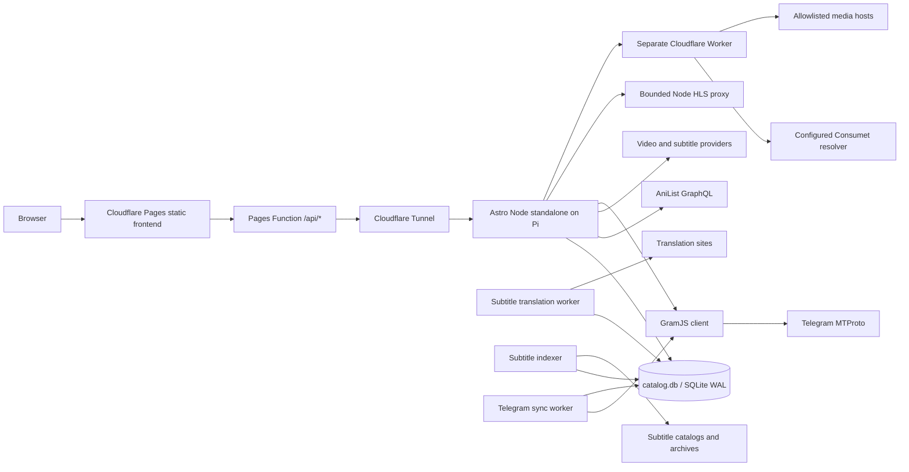

# Reliability Audit and Architecture Map

Audit started on 2026-11-17 on branch `production-hardening`. Existing working-tree changes were present before this audit and are preserved. This document records the baseline and highest-risk gaps before remediation.

## Architecture map

### Public and administrative boundaries

- The browser loads a statically generated Astro site from Pages. Pages Function `functions/api/[[path]].ts` forwards API paths to the configured HTTPS backend origin.
- The Raspberry Pi runs Astro's standalone Node adapter. Dynamic `/api/*` routes use the Pi's SQLite catalog and access external providers; no container compose or unit files are tracked in this repository.
- A separate Cloudflare Worker (`worker/index.ts`) proxies configured Consumet resolver calls and legacy/media HLS routes. It is a distinct runtime from the Pi API proxy.
- HLS fetches in the Node path use exact provider rules, public DNS validation, pinned connection lookup, redirects revalidated per hop, byte limits, cancellation, and bounded active/waiting slots.
- Telegram and subtitle administration routes require exact bearer tokens and fail closed when tokens are absent. Public catalog, stream, subtitle, and Telegram media routes do not require admin credentials.
- SQLite tables for subtitles and Telegram are initialized by module imports. `src/lib/db.ts` opens the catalog read-only; worker/storage modules open it writable.

## Baseline verification

- `npm run build`: **passed**. Vite emitted a large-chunk warning; static generation completed.
- `npm run subtitles:test`: **36 passed**. This includes live Qwen and online translation-provider probes; the configured Qwen model and all four active translation adapters responded during this run.
- `npm run test:proxy`: **22 passed**.
- `npm run test:admin`: **10 passed**.
- All discovered `*.test.ts` in `src`, `worker`, and `tools`: **93 passed, 6 failed, 1 skipped**. Two failures were live provider availability (AllAnime HTTP 500; ReAnime returned no search hit). Four E2E failures could not connect because local resolver/Worker services on ports 3000/8787 were not running. The authorized-media test was intentionally skipped.
- `npm audit --omit=dev`: **0 production advisories**.
- Docker daemon and project container definitions are unavailable in this checkout, so container runtime behavior was not verified.
- No production host, Cloudflare settings, secrets, or user data were changed during the baseline.

## Prioritized reliability findings (baseline)

| Priority | Finding | Impact | Recovery or verification gap |
|---|---|---|---|
| P1 | Database path was not consistently selected: `src/lib/db.ts` used checkout-relative `data/catalog.db`, while writable stores honored `CATALOG_DB_PATH`. | A configured path could split catalog reads from worker writes. | **Remediated in code:** shared path resolver and isolated unit test. Pi service environment still needs verification. |
| P1 | Liveness/readiness routes were absent; Telegram process had no persistent heartbeat. | Monitoring could not distinguish a dead loop from a usable worker. | **Partially remediated:** safe `/api/health/live` and `/api/health/ready`, SQLite worker heartbeat for subtitle/index/Telegram processes. Systemd watchdog/restart behavior remains host-dependent. |
| P1 | Worker resolver JSON `fetch()` calls lacked timeout and response-size limits. | A stalled or large response could consume Worker resources. | **Remediated in code:** explicit deadline, bounded streaming body read, cancellation and safe errors; mocked regression tests pass. |
| P1 | No tracked backup/verification tool existed. | Device loss or file/DB mismatch could make records/assets unrecoverable. | **Partially remediated:** opt-in atomic SQLite snapshot + immutable subtitle asset copy + hashes/integrity checks; restore is opened and verified in temporary tests. No scheduled/off-device backup or production restore drill verified. |
| P1 | Subtitle job records and event logs had no bounded retention; several in-memory provider caches and per-host wait queues could grow. | Long-running operation could exhaust USB storage/RAM or leave work waiting indefinitely. | **Partially remediated:** bounded logs, expiring provider misses, capped HTTP/PlayTube/OpenSubtitles caches, bounded host-registry/queues; job/dead-letter/artifact retention remains intentionally preserved and needs separate capacity policy. |
| P2 | Telegram sync and media requests can hang inside GramJS RPC/iterator operations. | Slow MTProto calls can hold a sync lease or keep a media response open indefinitely. | **Remediated in code, integration partially verified:** configurable per-operation deadline, disconnection of the stalled client, separate sync/media clients, abortable sync-page waits, and checkpoint persistence on graceful cancellation. Deadline helper tests pass; real GramJS outage/reconnect and Pi behavior remain unverified. Checkpoints are batched every 25 messages to reduce Pi writes. |
| P2 | Provider search and stream resolution can fan out to several upstreams. Provider interface does not accept AbortSignal, so a returned timeout may leave upstream work running. | Abandoned upstream work may consume slots after the client is gone. | **Partially remediated:** process-wide active/waiting caps and cancellation while queued; cancellation of already-running provider requests requires a provider-interface change and remains open. |
| P2 | Production service restart/resource limits were not tracked as deployable unit definitions. The read-only Pi audit recorded `MemoryMax=infinity`, `CPUQuota=infinity`; Docker is absent. | Crashes may not restart predictably, and competing API/workers can use all host resources. | Proposed web, subtitle-worker, and Telegram-sync systemd units now define bounded restart bursts, loopback binding, sandboxing, and per-process memory/CPU/task ceilings. They are not installed or validated on the Pi; verify cgroup/systemd capability and real workload headroom before activation. |
| P2 | End-to-end and live provider tests require services/public sites and fail when those dependencies are unavailable. | CI can confuse infrastructure absence with application regressions or a provider outage. | Keep unit tests isolated; label live tests and fail/skip only with explicit dependency evidence. |
| P3 | Frontend loading/error recovery is implemented per component rather than through a shared request/error boundary. | Individual journeys may show stale or indefinite loading after a network failure. | **Partially remediated:** playback now fails out after 45 seconds, offers retry/provider fallback, and tears down media; subtitle-polling, search, and admin recovery need browser-level verification. |

## Recovery ownership

- API process: systemd on the Pi (unit behavior must be verified on the host); database remains on persistent local storage.
- Subtitle translation: persistent `subtitle_jobs` state, job locks, retries, dead letters, and worker heartbeat in SQLite.
- Subtitle discovery/index: persistent index jobs with stale-lock recovery; sequential indexer process.
- Telegram: message IDs and sync checkpoint persisted in SQLite; repeated scans are idempotent by `(channel_id,message_id)`.
- Playback: providers resolve independently; Node proxy validates each destination and bounds fetches; Worker and Node proxy paths must be verified separately.
- Backups: `npm run catalog:backup -- <destination-directory>` writes a verified snapshot outside the source paths. Automated tests open a restored snapshot and check its assets; scheduling, off-device copy, and the live Pi restore drill are unverified.

## Remediation status and current evidence (2026-11-17)

- **Implemented and tested:** shared catalog DB path resolution; safe liveness/readiness responses; stale worker heartbeat persistence and admin visibility; expiring Telegram sync owner lease; bounded JSON bodies on selected administrative/catalog mutation routes; configurable in-process bounded concurrency/queues for provider search, resolution and metadata; Pages-to-backend header deadline and client cancellation; Worker resolver and HLS manifest response deadlines/size caps; canceled redirect-body cleanup; bounded archive decompression; subtitle body and indexed-asset hash/path verification; backup validation against SQLite asset references; bounded GPU and disk telemetry in subtitle admin.
- **Tested locally:** latest `npm run build`; `npm audit --omit=dev` (0 production vulnerabilities); latest broad suite 175 tests (170 passed, 4 failed, 1 skipped). Four failures were E2E checks that could not connect to local services on ports 8787/3000; the opt-in media E2E is skipped. AllAnime/ReAnime adapter tests use mocked HTTP responses. Focused subtitle-index retry/storage suites passed 32; Telegram deadline and bounded-client-pool suites passed 11; Telegram admin route suite passed 11 with pool telemetry shape. Stale recovery, archive expansion, asset-integrity and backup restore tests are included. A separate local restore-copy drill passed backup verification, read-only database integrity, core table-count checks, and a restored subtitle-asset lookup; it did not exercise service startup or Pi/off-device recovery. Unavailable services are not passing results.
- **Partially implemented:** per-process global and endpoint request token buckets; the Cloudflare client address is used only from an explicitly configured trusted socket-peer CIDR. Limits are not shared across processes or replicas.
- **Not implemented:** persistent shared concurrency limits outside Telegram sync, automatic backup scheduling/offsite replication, comprehensive frontend error boundary, and host-level CPU/memory/disk alerts.
- **Not verified:** proposed Pi service units (including supported directives and restart behavior), sustained workload/resource ceiling, production backup restore, ARM64 clean install/build, actual Cloudflare tunnel health behavior, and E2E against live local services. A current read-only SSH status query was denied by the host (`Permission denied (publickey,password)`), so no current systemd properties were observed.
- **Public reachability blocker (read-only probe, 2026-11-17):** `anineko.eu/` returned HTTP 200; `/api/health/live` on the apex, Pages preview, and `api-origin.anineko.eu` returned the site's HTML 404; two public DNS-over-HTTPS resolvers returned NXDOMAIN for `api.anineko.eu`. Read-only Cloudflare API inspection confirmed the Pages project/domain is active, there is no DNS record for the intended API hostname, and production's `ANINEKO_API_ORIGIN` binding is empty. Tunnel `anineko-pi-origin` reports healthy and has a resolved CNAME ingress `api-origin.anineko.eu` to HTTP loopback port 4321, but that endpoint also returns 404 on the health route. The latest Pages deployment metadata reports successful deploy and `uses_functions=true`; local Wrangler compilation of checked-out Pages Functions generated an `/api/*` route, but the public 404 does not match the checked-out handler's fail-closed 503. The API is unavailable and deployed Function routing/configuration requires investigation. No Cloudflare configuration was changed.
- **Still operational risks:** DNS pinning is unavailable in the Cloudflare Worker runtime code path; active external requests cannot all be forcibly cancelled because provider interfaces omit signals; the available local test sweep still has E2E failures when the Worker/API services are not running.
- After the broad sweep, subtitle normalization gained input-byte, cue-count, and cue-text ceilings; the focused normalizer suite passed 9/9. Subsequent production builds passed after later changes as well.
- Subsequent reliability work added retry ceilings for stale translation/index jobs, DNS-pinned exact-host subtitle downloads, exact-host-only HTTP for the legacy SAB.BZ host, Telegram operation deadlines with graceful sync cancellation, and a bounded per-stream Telegram client pool. Verify current results in `RELIABILITY_PROGRESS.md`; broad test results continue to include live-provider failures and unavailable local E2E services.

## Scope and operational limits

This audit does not authorize deployment, Cloudflare changes, service restarts, credential changes, destructive tests, migrations of production data, or a live restore. Resource limits added here must be verified against the Pi's measured memory-controller availability and actual service workload before they are applied to production.

## Superseding production status (2026-11-17)

The preceding reachability finding is a historical snapshot and is resolved for the current release. Under the later explicit production-release authorization, application commit `65e975270e159d3389c5b3f8b21e19af529c1c14` was deployed to the Pi and Cloudflare Pages. DNS `api.anineko.eu` points to the existing healthy tunnel, whose ingress targets `http://127.0.0.1:4321`; Pages has the production `ANINEKO_API_ORIGIN` secret binding and live API requests verify forwarding. The reported `api-origin` 404 did not reproduce during this verification: its health path currently returns 200, so that compatibility route was retained.

Verified on the deployed release: Pages and direct API liveness/readiness return 200; unauthenticated subtitle/Telegram administration returns 401; provider search returns results; Chromium playback advances unmuted for 11.9 seconds with 1280×720 video and byte-range delivery; the BG WebVTT endpoint returns 565 cues; web, translation worker, queue-only subtitle indexer, Telegram sync, tunnel, and recovery timer are active; database integrity and foreign-key checks are clean. A verified pre-deploy database plus 138-asset backup exists at `/srv/anineko/.deploy-backups/pre-65e9752/`; no production restore was performed.

Remaining readiness gaps: four local E2E tests could not connect to unavailable resolver/Worker listeners at ports 3000/8787; Pi memory cgroup enforcement is unavailable; sustained resource-ceiling and disk-exhaustion behavior, off-device backups, and a production restore drill remain unverified. The latest dependency audit also has 11 high-severity package paths through one `picomatch` advisory with no published fix. These gaps keep the broad reliability mission below READY.
